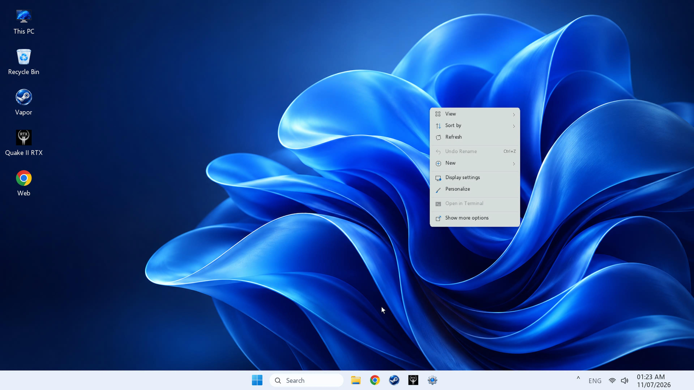
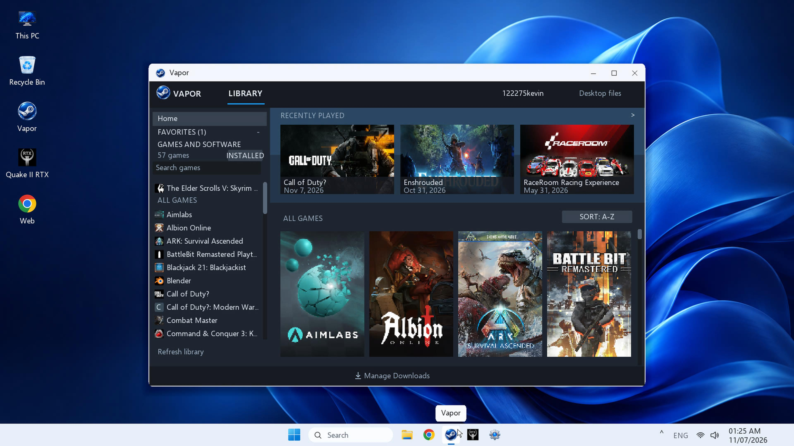
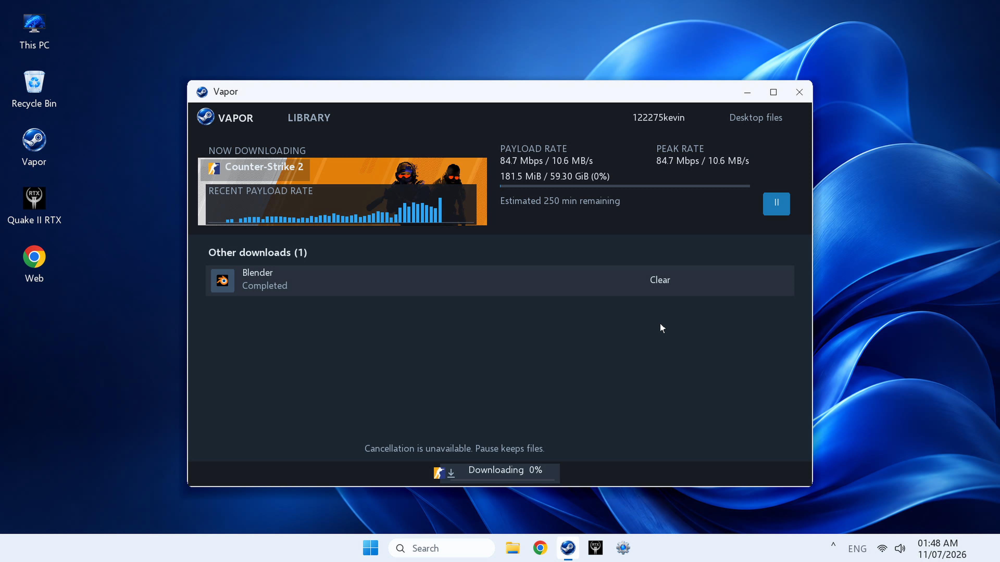

# WinBrew 11 / Vapor

A Windows 11-inspired desktop and Steam game library for PS5 homebrew, created by **KPKev** with AI development assistance. Supported Windows games use Playden's Wine-based PS5 runtime. WinBrew 11 is an independent homebrew application; it does not install Microsoft Windows.

**Updated November 7, 2026:** hotfix **cs2-runtime-v1.1** is installed on the owner's PS5, and the owner confirmed CS2 opens through Vapor after its managed runtime refresh. The current application is **PPSA77382**, version **01.016.000**. This repository contains its current source, tests, runtime-selection logic, and build tools.

## Working games

| Game | Confirmed result | Multiplayer scope |
| --- | --- | --- |
| **Schedule I** | Working, owner-reported. | Multiplayer/co-op has not been established by this report. |
| **Counter-Strike 2 (Steam app 730, called “CSGO” in owner reports)** | Offline gameplay with bots works. The complete fixed runtime is selected automatically during normal CS2 installation/reinstallation. | LAN/local multiplayer **may work but is untested**. Internet tunneling is also untested. In-game Steam authentication and official online matchmaking remain unsupported. |
| **The Elder Scrolls V: Skyrim Special Edition** | Working, owner-reported. | Offline report; co-op untested. |
| **Blackjack 21: The Blackjackiest** | Working, owner-reported. | Offline report; co-op untested. |
| **Golf With Your Friends** | Working, owner-reported. | Offline report; co-op untested. |
| **Quake II RTX** | Working, owner-reported. | Offline report; co-op untested. |

The tested Counter-Strike installation is CS2/app 730, not a separately tested legacy CS:GO executable. See the [compatibility matrix](docs/compatibility.md).

## Prepared for the next combined release

The Blender compatibility changes are integrated into normal installation/reinstallation. The owner confirmed workspace visibility, smooth pointer/menus and responsive wheel zoom; the owner confirms the earlier unexpected exit was resolved by the cursor repair. Kane's Wrath currently reaches only its first splash screen. Splitgate reaches login and is blocked by server authentication. See [compatibility](docs/compatibility.md), [Blender runtime details](docs/blender-runtime.md), and the [prepared release notes](docs/release-notes-next.md).

Counter-Strike's confirmed result is offline play. Online play does not work for the listed games and official online support is not being pursued. Co-op may be investigated later using other GitHub projects, but it remains unimplemented and untested. That work is deferred; the current priority is making the games function locally. The prepared update has not replaced the published downloads below.

## Get the latest runnable version

**Start with a PS5 that already has its jailbreak running.** You also need a computer on the same network, a way to copy files to the PS5, and a homebrew loader that adds apps from `/data/homebrew` to the PS5 Home screen. The guide explains these pieces before you copy anything. You do not need to build the source code.

### Required PS5 payloads and DNS

Vapor uses Playden's underlying runtime, so the console still needs its supporting payloads. **You do not need to install the separate Playden app.** Before opening WinBrew/Vapor, check:

- **[kstuff](https://github.com/EchoStretch/kstuff-lite)** is loaded for game execution.
- **[ShadowMountPlus](https://github.com/drakmor/ShadowMountPlus)** is running and scanning `/data/homebrew` so the app and game tiles can appear on Home.
- **[elfldr](https://github.com/ps5-payload-dev/elfldr)** is running on **port 9021** for the privileged filesystem helper. Your jailbreak loader may start it automatically.
- **Working DNS and Internet access on the PS5.** If the PS5's DNS is **`127.0.0.1`**, start **[nanoDNS](https://github.com/drakmor/nanoDNS)** or another DNS server listening on that address. Without one, Steam hostnames cannot resolve. nanoDNS is not required when another working DNS server is configured.

**After a full PS5 restart, reload the jailbreak and required payloads before launching the app.** A visible Home tile or saved Steam login does not prove they are running. See the [payload and DNS setup steps](docs/getting-started.md#before-you-start) and [upstream Playden requirements](https://github.com/leolobato/playden-ps5#requirements); upstream version/firmware results do not establish WinBrew compatibility on every console.

### Download and install

1. Open the [current release](https://github.com/KPKev/WinBrew-11/releases/tag/cs2-runtime-v1.1). Under **Assets**, download **Vapor-CS2-019.1.zip**, **Vapor-base-kit-0.13.zip**, **SHA256SUMS.txt**, and **fix-vapor-install-modes.py**. The base kit is needed for a first installation.
2. Extract the ZIPs on your computer. Copy the complete **PPSA77382** folder to **`/data/homebrew/PPSA77382`** on the PS5. Copy **playden-kit** to **`/data/wine11/kits/playden-kit`**. Keep every file and subfolder; copying only `eboot.bin` is incomplete.
3. Check the copied files' permissions using the supplied helper, let your homebrew loader scan the app folder, then launch **WinBrew 11** from Home. Open **Vapor** inside it and sign into your own Steam account.

**Follow the [step-by-step installation guide](docs/getting-started.md) for the full walkthrough**, including download checks, exact folder layouts, permission commands, and first-launch checks. Already installed? Use its [update steps](docs/getting-started.md#updating-an-existing-installation). Stuck? See [troubleshooting](docs/troubleshooting.md).

The downloads above are for the documented `cs2-runtime-v1.1` release. Check the [latest release](https://github.com/KPKev/WinBrew-11/releases/latest) for newer versions and follow that version's instructions if its files differ. GitHub's **Code → Download ZIP** and automatic **Source code** archives contain source, not the ready-to-run PS5 application.

Clone or pull **main** for current code and documentation. SDKs, downloaded runtimes, and generated outputs are separate from Git. The [source-build guide](docs/source-build.md) explains the prerequisites and full target, `tools/build-vapor-cs2.sh`. The historical desktop-only `build-ps5.sh` is not the complete current Steam/Vapor application.

## Included in the combined update

The v1.1 hotfix sends an existing Ready CS2 installation through preparation when its selected runtime is not current, instead of skipping directly to a refused launch. All 11 installed titles passed the runtime inventory/folder-ownership audit. See the [hotfix verification report](docs/reports/cs2-handoff-20261107.md) for scope and the legacy manual-install ownership correction.

- Steam sign-in, automatic game discovery, downloads, and per-game preparation through the existing Playden services.
- Persistent per-game hero images, logos, icons, covers, portraits, store descriptions/genres, and news snapshots. Successfully cached content is reused after restart rather than silently replaced when Steam changes it.
- A **Refresh game cache** button on each game's detail page to clear that game's saved presentation data and request the latest content. Ownership, installation, download, and launch decisions remain live service data.
- Mouse, USB keyboard, and controller input; desktop/Start/taskbar shortcuts; favorites and library search; download controls and per-game controller settings; Paint, Notepad, and a system-browser launcher.
- The window-shadow fix that the owner confirmed made Vapor smooth: hidden window pixels are no longer blended 18 times per frame. Further improvements cache glyph coverage, Recent Games ordering, shortcut labels, and download-view updates.
- Automatic complete **cs2-019.1** runtime selection for Steam app 730, including the tested derived `ntdll.prx`. Other games retain their configured/base runtime.
- Unlocked default profiles for Skyrim Special Edition, Terraria, Brotato, and Counter-Strike: Source. Profiles do not establish gameplay compatibility, and saved player settings retain precedence.

## Verification

The combined installed package has **1,856 files**. Application/runtime contents, applicable file modes, and the final manifest were verified against pinned hashes. The app reopened successfully and its Steam startup and input initialization passed. Tests cover cache persistence/reset, pixel-identical text/shadows, library discovery, input, downloads, save-preserving migration, and complete CS2 runtime first-install/reinstall paths.

Owner gameplay reports are separate from host tests and startup checks. Local rendering benchmarks are **not PS5 FPS measurements**. A fixture reinstall is not a claim that the owner's entire CS2 download was repeated. See [current verification](docs/current-status.md) and the [changelog](CHANGELOG.md).

## Screenshots

Existing PS5 captures show the desktop and Vapor interface:

## Credits and history

WinBrew 11 uses the original Playden/prospero-win work and the components identified in [THIRD_PARTY_NOTICES.md](THIRD_PARTY_NOTICES.md). This project is GPL-3.0-or-later; runtime components retain their own licenses and corresponding-source obligations. No commercial game files, Steam accounts, or saves are included.

Earlier prototypes and acceptance notes remain in the [historical desktop archive](docs/history/desktop-development.md). PPSA77381 packages and experimental commands in that archive are not the current installation path.
