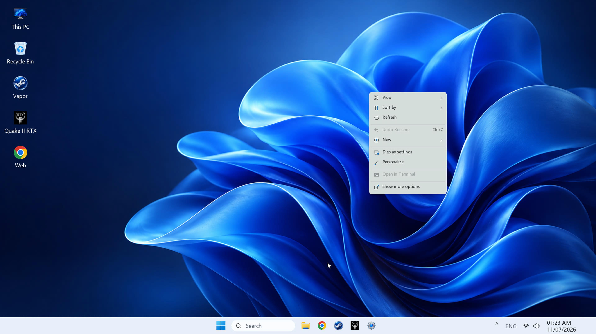
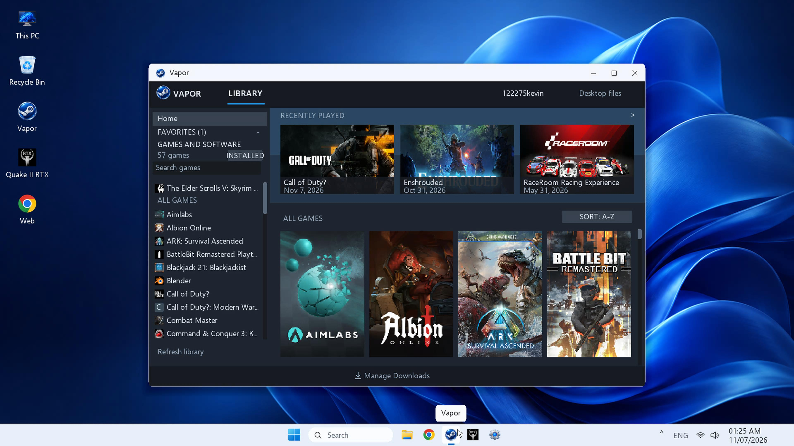
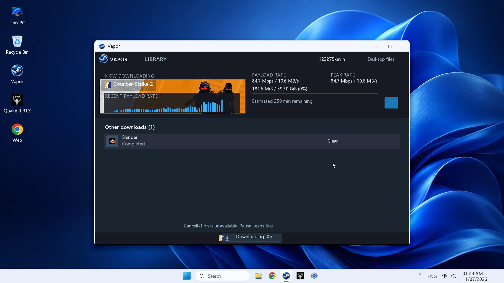

# WinBrew 11 / Vapor

A Windows 11-inspired desktop and Steam game library for PS5 homebrew, created by **KPKev** with AI development assistance. Supported Windows games use Playden's Wine-based PS5 runtime. WinBrew 11 is an independent homebrew application; it does not install Microsoft Windows.

> [!WARNING]
> **Active development: game compatibility can change between builds.** Some previously working games may temporarily fail to launch or behave unexpectedly after code changes. **Skyrim Special Edition is currently reported not working.** Earlier compatibility reports are historical results, not guarantees for this build. Please check back often for updates and fixes.

**November 16, 2026 — [v1.18.0: Vapor backend updates](https://github.com/KPKev/WinBrew-11/releases/tag/v1.18.0):** Playden 0.11.0 and runtime kit 0.28, startup/manual update checks, compatible app/runtime updates with restart and rollback, and gold preparation progress. Includes saved-session/library restoration, Blender/application visibility and generic launch fixes. [Release notes](docs/release-notes-next.md) · [Backend update guide](docs/vapor-backend-updates.md) · [Verification](docs/vapor-backend-verification.json).

## Blender: download, install, Play

Once WinBrew and its standard console prerequisites are installed, open **Vapor**, sign into the Steam account containing Blender, refresh the library, then **download/install Blender and press Play**. Normal preparation applies the compatibility fixes automatically. No Python-console commands, title-folder renaming, permission repair experiments or manual copying between Wine and WinBrew Documents are part of Blender setup.

For an existing Blender installation, update WinBrew and press **Play in Vapor once** so its managed runtime and folder access are upgraded. The PS5 Home tile then uses the same launcher. Blender's Documents/Desktop shortcuts point to WinBrew's actual folders; seeing the virtual Windows user name `prospero` does not mean a second copy is being saved.

The work crossed Steam application filtering, runtime receipt migration, Wine profile mapping, PS5 filesystem permissions, secondary-window rendering and a missing Windows recycle API. Fixing only the launch or Save As path was not sufficient. The [engineering report](docs/reports/blender-automatic-integration-20261116.md) explains the failures, safeguards, tests and remaining limits in detail.

## Game status and earlier reports

| Game/application | Status and confirmed scope |
| --- | --- |
| **Skyrim Special Edition** | **Current regression: owner reports it is not working.** It worked in an earlier build; a fix is pending and the cause has not been established. |
| **Enshrouded** | Owner confirmed the game starts and runs after scoped preparation-state recovery. Long-session, save/load and multiplayer coverage remain unverified. |
| **Counter-Strike 2 / Steam app 730** | Earlier owner-confirmed offline gameplay with bots; the fixed runtime is preserved. Official in-game Steam authentication/matchmaking remain unsupported. |
| **Schedule I; Blackjack 21; Golf With Your Friends** | Earlier owner-reported working results. They have not all been re-tested against this desktop/storage build. |
| **Blender** | Automatic Vapor preparation; owner-confirmed shared Documents/Desktop save/reopen, visible Save As, file-browser recycling without black windows, and normal opening of the original project. Large scenes, rendering/exporting and long sessions remain unverified. |
| **Kane's Wrath** | First splash only; no confirmed menu/gameplay. A path-handling experiment remains unqualified and is not a promised fix in this release. |
| **Splitgate** | Reaches login but is blocked by server authentication; no playable result confirmed. Community offline/LAN ideas remain untested here. |

The owner also reports another affected game whose title has not yet been identified. See the [compatibility matrix](docs/compatibility.md) for current regressions, historical results and multiplayer limits. The tested “CSGO” report refers to CS2/app 730, not a separately tested legacy CS:GO executable.

## Get the latest runnable version

**Start with a PS5 that already has its jailbreak running.** You also need a computer on the same network, a way to copy files to the PS5, and a homebrew loader that adds apps from `/data/homebrew` to the PS5 Home screen. The guide explains these pieces before you copy anything. You do not need to build the source code.

### Required PS5 payloads and DNS

Vapor uses Playden's underlying runtime, so the console still needs its supporting payloads. **You do not need to install the separate Playden app.** Before opening WinBrew/Vapor, check:

- **[kstuff](https://github.com/EchoStretch/kstuff-lite)** is loaded for game execution.
- **[ShadowMountPlus](https://github.com/drakmor/ShadowMountPlus)** is running and scanning `/data/homebrew` so the app and game tiles can appear on Home.
- **[elfldr](https://github.com/ps5-payload-dev/elfldr)** is running on **port 9021** for the privileged filesystem helper. Your jailbreak loader may start it automatically.
- **Working DNS and Internet access on the PS5.** If the PS5's DNS is **`127.0.0.1`**, start **[nanoDNS](https://github.com/drakmor/nanoDNS)** or another DNS server listening on that address. Without one, Steam hostnames cannot resolve. nanoDNS is not required when another working DNS server is configured.

**After a full PS5 restart, reload the jailbreak and required payloads before launching the app.** A visible Home tile or saved Steam login does not prove they are running. See the [payload and DNS setup steps](docs/getting-started.md#before-you-start) and [upstream Playden requirements](https://github.com/leolobato/playden-ps5#requirements); upstream version/firmware results do not establish WinBrew compatibility on every console.

### Download and install

1. Open the [current release](https://github.com/KPKev/WinBrew-11/releases/tag/v1.18.0). Under **Assets**, download **WinBrew-11-v1.18.0.zip**, **SHA256SUMS.txt**, and **fix-vapor-install-modes.py**. For this upgrade and for new installations, also download the matched **Vapor-backend-kit-0.28.zip** from the same release.
2. Extract the ZIPs on your computer. Copy the complete **PPSA77382** folder to **`/data/homebrew/PPSA77382`** on the PS5. Copy **playden-kit** to **`/data/wine11/kits/playden-kit`**. Keep every file and subfolder; copying only `eboot.bin` is incomplete.
3. Check the copied files' permissions using the supplied helper, let your homebrew loader scan the app folder, then launch **WinBrew 11** from Home. Open **Vapor** inside it and sign into your own Steam account.

**Follow the [step-by-step installation guide](docs/getting-started.md) for the full walkthrough**, including download checks, exact folder layouts, permission commands, and first-launch checks. Already installed? Use its [update steps](docs/getting-started.md#updating-an-existing-installation). Stuck? See [troubleshooting](docs/troubleshooting.md).

The app download above is the **v1.18.0** development release. Use its matched **0.28** base kit; the earlier 0.13 kit is for earlier app versions. Older Vapor versions require this update to be installed manually once; future compatible releases can use **Backend Updates**. Check the [latest release](https://github.com/KPKev/WinBrew-11/releases/latest) for newer versions and follow that version's instructions if its files differ. GitHub's **Code → Download ZIP** and automatic **Source code** archives contain source, not the ready-to-run PS5 application.

Clone or pull **main** for current code and documentation. SDKs, downloaded runtimes, and generated outputs are separate from Git. The [source-build guide](docs/source-build.md) explains the prerequisites and full target, `tools/build-vapor-cs2.sh`. The historical desktop-only `build-ps5.sh` is not the complete current Steam/Vapor application.

## Included in this development update

- **Windows-style File Explorer:** tabs, back/forward/up navigation, breadcrumbs, address entry, current-folder search, a left-aligned navigation tree, real drive capacity bars, Details/List/Tiles views, sorting, text preview, multiple selection and drag/drop.
- **File operations:** deleted files appear in the Recycle Bin, can be restored or deleted individually, and Empty Recycle Bin asks for confirmation. Older recovery stores are collected with safeguards. Cross-drive recycling verifies copies before removing originals. Mouse and controller context menus expose file actions.
- **Start and personalization:** pin or unpin built-in apps to the desktop, Start and taskbar; context menus keep the chosen Start or All Apps item visible. Change the display name in Personalization (default **WinBrew**); the existing folder path stays stable.
- **Large C: and personal folders:** C: represents `/data`, the large console storage previously displayed as D:. Personal folders live in `C:\WinBrew\Users\Default`. The first successful startup copies and verifies the six known personal folders, including recovery stores, before switching; originals remain available. Internal account/settings state stays in its existing private location. No partition resizing is performed.
- **Console Root:** browse other accessible console paths. These are real files; edits affect the console. Use Vapor or the console's uninstall flow for registered games rather than deleting their folders manually.
- **Removable storage:** actual mounted USB/extended storage appears with its real size and disappears on unplug, normally within about two seconds. Empty connection folders no longer appear as 2 MB drives.
- **Notepad:** redesigned Windows 11-inspired interface, tabs, find and replace, undo/redo, editable Save/Save As and close-prompt names, replacement confirmation and preservation of unsaved edits on failure. The owner confirmed physical-keyboard typing on PS5.
- **Paint and Spreadsheet:** drawing/image tools plus CSV and bounded `.xlsx` open/edit/save, worksheet switching and workbook-part preservation. These are built-in WinBrew applications, not Microsoft Office or feature-complete replicas. See [Office capabilities and limits](docs/office-apps.md).
- **Vapor feedback:** gold status messages and a smoothly pulsing Play button while Preparing/Starting, shared by game pages. An animation indicates activity, not guaranteed successful preparation.
- Existing library discovery, Steam sign-in/downloads, cached artwork/news, per-game controls and pinned CS2/Blender runtime bundles are retained.

See [Explorer and storage](docs/explorer-storage.md), [file actions](docs/file-context-actions.md), [Notepad Save As](docs/notepad-save-as.md), and the [changelog](CHANGELOG.md).

## Verification

I tested this update on my PS5. Deleted files appeared in the Recycle Bin, restored to their original location, and were removed when I chose to empty it. Separate PS5 tests used disposable files to check cancellation, older-bin recovery, restore and deletion; a file outside the test bin was preserved. Physical keyboard typing was confirmed in the earlier Notepad update. Game reports remain scoped as described above.

## Screenshots

Existing PS5 captures show the desktop and Vapor interface:

## Credits and history

WinBrew 11 uses the original Playden/prospero-win work and the components identified in [THIRD_PARTY_NOTICES.md](THIRD_PARTY_NOTICES.md). This project is GPL-3.0-or-later; runtime components retain their own licenses and corresponding-source obligations. No commercial game files, Steam accounts, or saves are included.

Earlier prototypes and acceptance notes remain in the [historical desktop archive](docs/history/desktop-development.md). PPSA77381 packages and experimental commands in that archive are not the current installation path.
